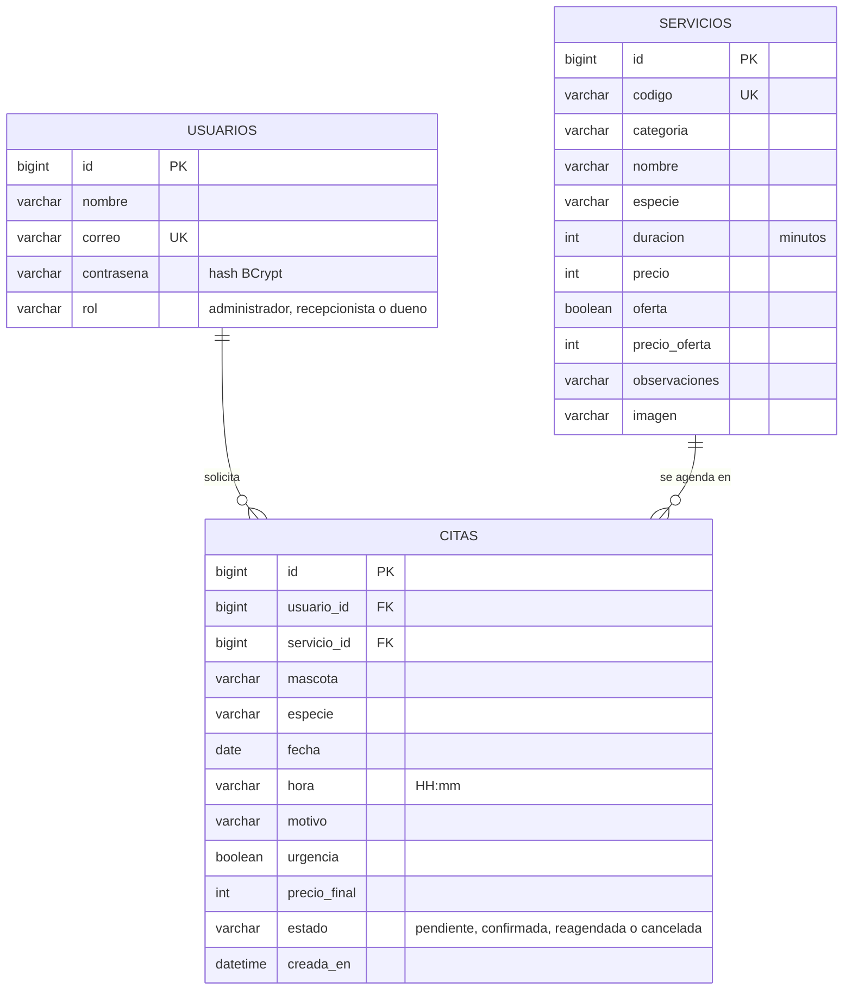
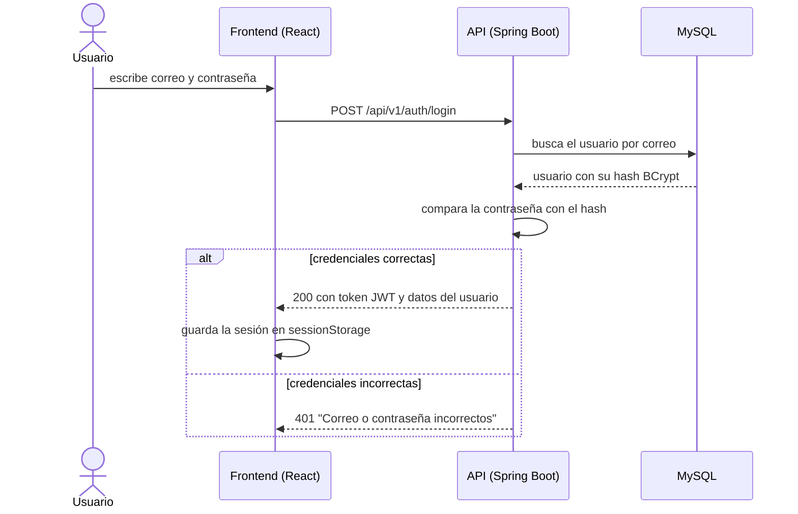
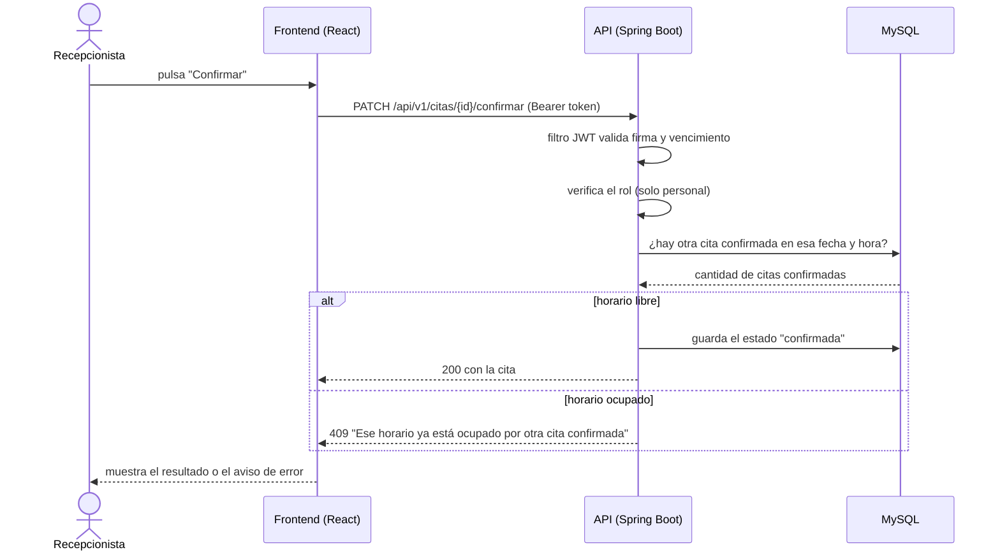

# Veterinaria San Marcos – Backend (API REST)

API REST del sistema de agenda de la **Veterinaria San Marcos** (Rancagua). Gestiona usuarios, catálogo de servicios y citas, con inicio de sesión mediante **JWT** y permisos por rol.

Proyecto del curso **DSY1104 – Desarrollo FullStack II** (Duoc UC), Parcial 3. Integrantes: Martin Cortes, Christian Montecinos y Alejandro Naranjo.

| Recurso | Enlace |
|---|---|
| Frontend (repositorio) | https://github.com/MartinCC77/veterinaria-Evaluacion1 |
| Documentación Swagger | http://52.45.85.64:8080/swagger-ui.html |
| Aplicación desplegada | http://52.45.85.64:5173 |

## Decisiones técnicas

| Decisión | Elección | Por qué |
|---|---|---|
| Lenguaje y framework | Java 21 y Spring Boot 4.1 | Es lo visto en el curso; Spring Security y Spring Data JPA resuelven la seguridad y el acceso a datos. |
| Base de datos | MySQL 8 con JPA/Hibernate | Base relacional para usuarios, servicios y citas, con claves foráneas que protegen la integridad. |
| Autenticación | JWT firmado con vigencia de 2 horas | La API no guarda sesiones en el servidor (stateless); el token lleva el id, el correo y el rol. |
| Contraseñas | Hash BCrypt | Nunca se guardan ni se devuelven en texto plano. |
| Permisos | Reglas en `SecurityConfig` y verificación de propiedad en los *services* | 401 sin sesión válida y 403 sin permiso; nadie ve datos de otra persona cambiando un id. |
| Estructura | `controller`, `service`, `repository`, `dto`, `model`, `exception`, `security`, `config` | Cada capa tiene una sola responsabilidad. |
| Entrada y salida | DTO con validaciones (`jakarta.validation`) | El cliente solo envía y recibe lo necesario; las entidades no se exponen. |
| Errores | Respuesta uniforme `{"mensaje": "..."}` con el código HTTP adecuado | Lo maneja `GlobalExceptionHandler`. |
| Versionado | Rutas bajo `/api/v1` | Permite evolucionar la API sin romper al frontend. |
| Documentación | springdoc-openapi (Swagger UI) | Muestra los códigos de respuesta y permite probar con token. |
| Secretos | Variables de entorno (`/etc/veterinaria.env`, permisos 600) | Ninguna clave está en el repositorio. |
| Despliegue | EC2 Ubuntu, servicio `systemd` | Arranca con la instancia y se reinicia si falla. |

## Cómo ejecutarlo

Requisitos: Java 21 y MySQL 8.

```bash
# 1. Crear la base de datos y un usuario (una sola vez)
sudo mysql
CREATE DATABASE veterinaria_db CHARACTER SET utf8mb4 COLLATE utf8mb4_unicode_ci;
CREATE USER 'veterinaria_app'@'localhost' IDENTIFIED BY '<tu_clave>';
GRANT ALL PRIVILEGES ON veterinaria_db.* TO 'veterinaria_app'@'localhost';
EXIT;

# 2. Definir las variables de entorno
export DB_PASSWORD='<tu_clave>'
export JWT_SECRET='<un-secreto-de-al-menos-32-caracteres>'
export CORS_ORIGINS='http://localhost:5173'

# 3. Iniciar la API
./mvnw spring-boot:run
```

La API queda en `http://localhost:8080`. Las tablas se crean solas y, si están vacías, se cargan los datos de demostración.

### Variables de entorno

| Variable | Obligatoria | Descripción |
|---|---|---|
| `DB_PASSWORD` | Sí | Clave del usuario de la base de datos. |
| `JWT_SECRET` | Sí | Secreto para firmar los tokens (32 caracteres o más). |
| `CORS_ORIGINS` | No | Orígenes del frontend permitidos, separados por coma. Por defecto `http://localhost:5173`. |
| `DB_HOST`, `DB_PORT`, `DB_NAME`, `DB_USER` | No | Por defecto `localhost`, `3306`, `veterinaria_db` y `veterinaria_app`. |

### Como servicio en el servidor

```bash
./mvnw -q -DskipTests package
sudo systemctl enable --now veterinaria-backend   # usa /etc/veterinaria.env
sudo systemctl status veterinaria-backend --no-pager
```

## Usuarios de demostración

Se crean al iniciar si la tabla de usuarios está vacía. Son datos de prueba.

| Rol | Correo | Contraseña |
|---|---|---|
| administrador | admin@sanmarcos.cl | admin123 |
| recepcionista | recepcion@sanmarcos.cl | recep123 |
| dueno | juan@correo.cl | dueno123 |

## Modelo de datos



## Diagramas de secuencia

### Inicio de sesión



### Confirmar una cita (regla del horario ocupado)



## Endpoints

Todas las rutas parten de `/api/v1`. Los marcados con *Token* exigen `Authorization: Bearer <token>`.

| Método y ruta | Acceso | Respuestas |
|---|---|---|
| `POST /auth/login` | Público | 200, 400, 401 |
| `POST /auth/registro` | Público (el rol lo asigna el servidor) | 201, 400, 409 |
| `GET /usuarios` | Token: administrador | 200, 401, 403 |
| `POST /usuarios` | Token: administrador | 201, 400, 401, 403, 409 |
| `GET /usuarios/{id}` | Token: administrador o el mismo usuario | 200, 401, 403, 404 |
| `PUT /usuarios/{id}` | Token: el mismo usuario (el rol solo el administrador) | 200, 400, 401, 403, 404, 409 |
| `DELETE /usuarios/{id}` | Token: administrador | 204, 401, 403, 404, 409 |
| `GET /servicios`, `GET /servicios/{id}` | Público | 200, 404 |
| `POST /servicios` | Token: administrador | 201, 400, 401, 403, 409 |
| `PUT /servicios/{id}` | Token: administrador | 200, 400, 401, 403, 404, 409 |
| `DELETE /servicios/{id}` | Token: administrador | 204, 401, 403, 404, 409 |
| `POST /citas` | Token: cualquier perfil | 201, 400, 401 |
| `GET /citas?estado=` | Token: personal (todas) o dueño (propias) | 200, 400, 401 |
| `GET /citas/{id}` | Token: dueño de la cita o personal | 200, 401, 403, 404 |
| `PATCH /citas/{id}/confirmar` | Token: personal | 200, 401, 403, 404, 409 |
| `PATCH /citas/{id}/reagendar` | Token: personal | 200, 400, 401, 403, 404, 409 |
| `PATCH /citas/{id}/cancelar` | Token: dueño de la cita o personal | 200, 401, 403, 404, 409 |

## Reglas de negocio

- Horarios de atención: 09:00 a 12:00 y 15:00 a 17:30, cada 30 minutos.
- Solo las citas **confirmadas** ocupan un horario. Por defecto cabe una por franja; se cambia con `app.citas.maximo-por-horario`.
- La urgencia en una **consulta** suma $10.000; el precio final lo calcula el servidor.
- El precio de oferta debe ser menor al precio normal.
- La fecha de una cita no puede ser anterior a hoy.
- Un servicio o un usuario con citas no se puede eliminar (409). El administrador no puede eliminar su propia cuenta.
- Estados de una cita: `pendiente` → `confirmada` o `reagendada` → `cancelada`.

## Seguridad

- Contraseñas con BCrypt; la API nunca las devuelve.
- Token JWT con vencimiento a las 2 horas; el filtro valida firma y vencimiento en cada solicitud.
- 401 cuando falta el token o es inválido y 403 cuando el rol no alcanza.
- El registro público siempre crea usuarios con rol `dueno`; el campo `rol` enviado por el cliente se ignora.
- CORS limitado a los orígenes de `CORS_ORIGINS`.
- Secretos solo en variables de entorno; no hay claves ni archivos `.env` en el repositorio.

## Pruebas

El script `scripts/pruebas-integracion.sh` ejecuta **57 pruebas** contra la API en ejecución (autenticación y JWT, roles, CRUD de usuarios, catálogo y citas con el 409). Requiere `curl` y `python3`.

```bash
./scripts/pruebas-integracion.sh | tee docs/resultados-pruebas-integracion.txt
```

El resultado de la última ejecución está en `docs/resultados-pruebas-integracion.txt`.

## Estado del trabajo

| Parte | Diseñado | Implementado | Probado |
|---|---|---|---|
| Inicio de sesión con JWT y registro | Sí | Sí | Sí |
| Roles y permisos (401 y 403) | Sí | Sí | Sí |
| CRUD de usuarios | Sí | Sí | Sí |
| Catálogo de servicios | Sí | Sí | Sí |
| Citas y regla de horario ocupado (409) | Sí | Sí | Sí |
| Documentación Swagger | Sí | Sí | Sí (manual) |
| Despliegue como servicio systemd en EC2 | Sí | Sí | Sí (manual) |
| Categorías, reportes, servicios críticos e historial en el servidor | Sí | No (siguen en el frontend) | No |
| HTTPS, tokens de refresco y cookie httpOnly | Sí | No | No |
| Pruebas automáticas dentro del proyecto (MockMvc) | Sí | No | No |

## Estructura

```
src/main/java/cl/duoc/veterinaria/
├── config/       SecurityConfig, OpenApiConfig, DataInitializer
├── controller/   AuthController, UsuarioController, ServicioController, CitaController
├── dto/          objetos de entrada y salida
├── exception/    ApiException, GlobalExceptionHandler
├── model/        Usuario, Servicio, Cita
├── repository/   interfaces de Spring Data JPA
├── security/     JwtService, JwtAuthFilter, UsuarioAutenticado
└── service/      AuthService, UsuarioService, ServicioService, CitaService
```
